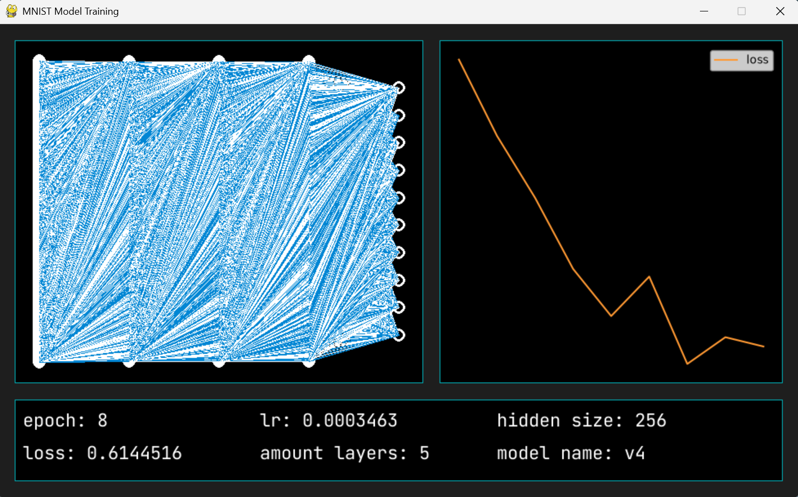
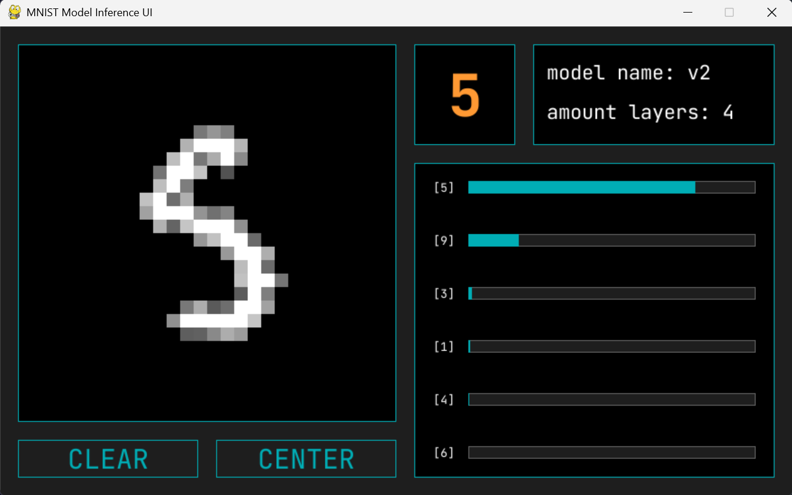
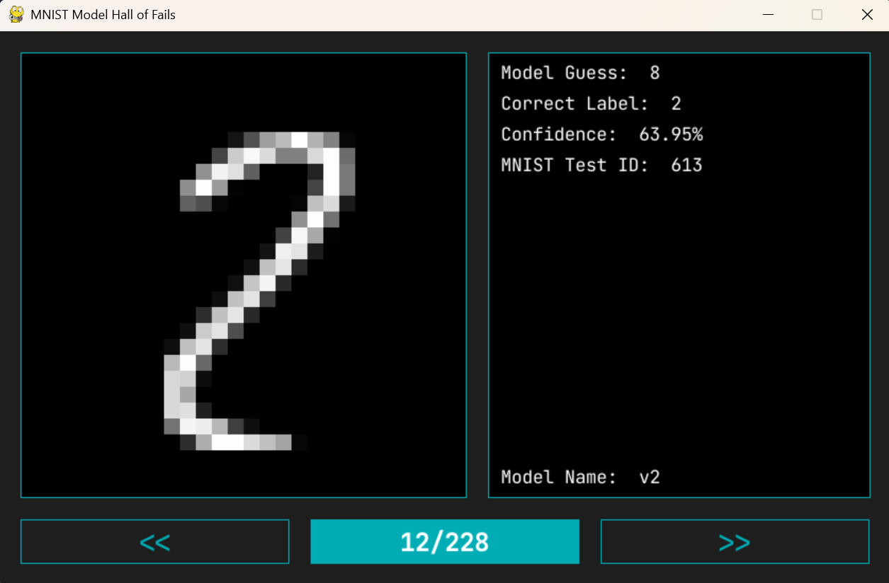

# MNIST Digit Recognition

A neural network algorithm that recognizes and classifies hand-drawn digits. Written in Python using my very own [barebones_ml](https://github.com/IAmDaanE/bare-bones-ml) neural network & machine learning library.

---

## About the Project

This repository contains a Python script to train the image classification algorithm, two pretrained models, a model's accuracy tester scipt, hall of fails where you can see what the tested model got wrong and a GUI environment where you can draw a digit and see the model's prediction in real-time.

I used the open-source **MNIST dataset**, which contains 70,000 labeled grayscale images (60,000 for training and 10,000 for testing). To make downloading and loading the data easier, I used the CSV format available [on Kaggle](https://www.kaggle.com/datasets/oddrationale/mnist-in-csv).

You can find the 2 pretrained models in the models/ folder, more info on them in models/README.md.


### Training



When running the training process a pygame window will open to follow some stats like the amount of hidden layers and the size of a hidden layer, the learning rate epoch and loss, the name of the model thats currenly being trained... In the top right there is also a nice line graph to visualize the progression of the loss and if wanted also learning rate. I wrote a pygame x matplotlib graphing library specifically for this usecase: [pgplot](https://github.com/IAmDaanE/pygame-plot). On top of that there is a visualization of the current network with its weights and nodes.

<br clear="right">

### Inference UI



To interactivelly test a trained model there is inference_ui.py, you draw a digit and see what the model thinks it is in real time. Contains a CENTER button which works with a sort of density map of where there is a lot of color and where there isn't to center your drawing inside the drawing square. This will ensure model accuracy. See the confidence scores changing live with the moving sort of bar plot made with pygame rects. Get the essential quick info from the information corner. Check the Get Started below to learn how to start this feature.

<br clear="right">

### Hall of Fails



When testing a models accuracy with tools/accuracy_tester.py it will save all the wrong guesses inside output/fails.json. Hall of Fails takes the data inside this and visualizes it in a nice ui. Go through all the images and see the weak points and what shapes and digits the model is having trouble with. It is also just useful to see how hard some of the images in the test set actually are, not even a human can score a 100% on this dataset.

<br clear="right">

## Project Structure

```text
ml-digit-classification/
├── data/                   # Directory for the MNIST dataset CSV files
├── models/                 # Pretrained models stored as pure NumPy arrays
    ├── v1/   
    └── v2/
├── src/
    ├── predict_drawing.py  # The GUI environment for drawing digits
    ├── train.py            # The main training loop
    └── utils.py            # Reusable helper functions
├── tools/
    ├── accuracy_tester.py  # Tests model accuracy on the test dataset
    ├── hall_of_fails.py    # Shows the wrong guesses
    └── utils.py            # Reusable helper functions
└── output/
    └── fails.json          # The output of accuracy_tester.py
```

## Getting Started

### Installing Libraries

**Requires:** Python 3.10 - 3.14

```
pip install -r requirements.txt
```

### Running the Inference UI

To test the pretrained model yourself, run the following command in the project root:
```bash
python src/inference_ui.py "models/v2" 
```
Want to use a different model? Replace the string with the path to the desired one.

### Training Your Own Model

Because the dataset files are too large for a GitHub repository, you will need to download `mnist_train.csv` and `mnist_test.csv` manually from [this Kaggle page](https://www.kaggle.com/datasets/oddrationale/mnist-in-csv).

1. Download the CSV files and place them inside the `data/` directory.

2. Open `src/train.py` and configure your desired hyperparameters.

3. Start the training process, replace the string with the location of where you want to stored the trained model's weights and biases:

   ```bash
   python src/train.py "models/v3"
   ```

4. When satisfied with the loss convergence during training, press `Ctrl + C` to safely stop training and save the trained weights and biases.

### Testing a Models's Accuracy

To measure the accuracy of a model run the following command in the project root:

```bash
python src/accuracy_tester.py "models/v2" 
```

Want to test a different model? Replace the string with the path to the desired one.

### Running the Hall of Fails

Use the following command in the project root:

```
python tools/hall_of_fails.py
```

This shows the fails of the latest model you tested the accuracy of.

## License

This project is open-source and available under the **MIT License**.
